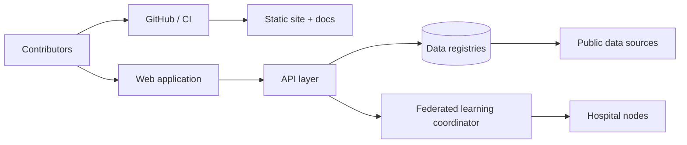

# LittleCures Architecture

This document describes the current and planned technical architecture of the LittleCures project.

## High-level design

## Current stack

- **Frontend:** Vite 5, React 18, TypeScript 5, Tailwind CSS, Lucide icons
- **Testing:** Vitest
- **Build and deploy:** pnpm, GitHub Actions, Vercel (recommended)
- **Version control:** Git + GitHub

This is intentionally small and fast. The landing site, documentation, and CI are real production artifacts, not placeholders.

## Planned components

### Web application

A React/TypeScript single-page application that serves as the public entry point. It will eventually include:

- Patient/clinician-facing trial search
- Target and IP registry browser
- Federated learning dashboard
- Public data downloads and API documentation

### API layer

A future service layer that provides:

- REST and/or GraphQL endpoints for registry data
- Search and ranking for trial matching
- Authentication and authorization for federated learning coordination
- Audit logging for all data access

The language and framework are not yet decided. We will choose based on contributor expertise, performance needs, and the availability of pediatric oncology libraries. Options include Node.js/TypeScript, Python/FastAPI, and Go.

### Data registries

The registry layer is the heart of the project. It will store and expose normalized records for:

- Diseases, subtypes, and molecular drivers
- Trials and eligibility criteria
- Patent families and licensing status
- Model systems and datasets
- Publications and derived analyses

We will align on standard ontologies and schemas where possible:

- **OMOP** for clinical observations
- **GA4GH Phenopackets** for patient phenotypes and genotypes
- **FHIR** for clinical interoperability
- **ICD-O-3 / WHO** for tumor classification

### Federated learning

A coordinator that orchestrates training across hospital nodes without centralizing raw data. The leading candidates are:

- **Flower** (Python, flexible, research-friendly)
- **NVFlare** (NVIDIA, enterprise-grade, clinical-oriented)
- **OpenFL** (Intel, production-hardened)

A pilot would require:

1. A minimal schema agreed with one or two hospital partners.
2. A reference coordinator and client.
3. A clearly scoped model (e.g., survival risk stratification).
4. IRB and legal review at each site.

### Deployment

- **Static site:** Vercel or Netlify, connected to GitHub with branch previews.
- **API and registry:** Cloud platform to be selected (e.g., Fly.io, Render, AWS, Cloudflare).
- **Federated coordinator:** Hospital-facing, likely self-hosted or run in a trusted neutral cloud.

## Security and privacy

- Patient data is not collected by LittleCures.
- Federated learning clients process data locally.
- All access to APIs and registries is logged.
- Code and infrastructure changes require review and CI approval.
- Security issues are handled through a private disclosure process.

## Decisions log

| Date | Decision | Rationale |
|------|----------|-----------|
| 2026-07 | Vite + React + TS + Tailwind for landing | Fast build, modern defaults, easy to contribute |
| 2026-07 | pnpm and GitHub Actions for CI | Deterministic, fast, free for open source |
